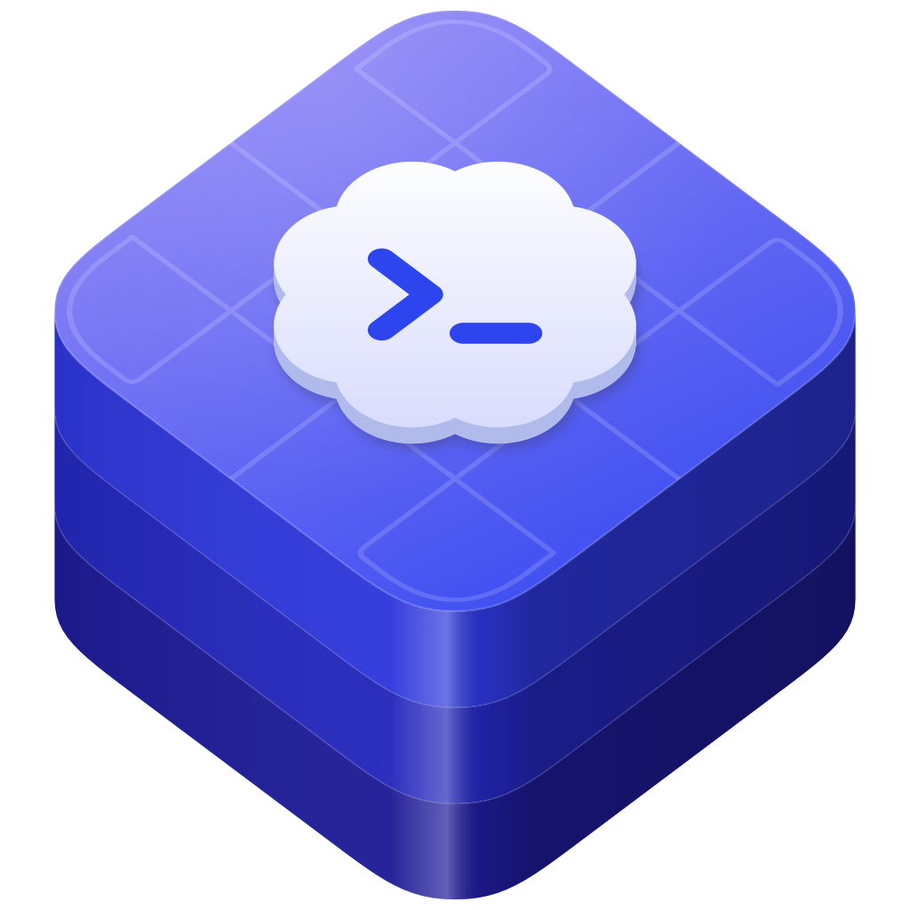

<p align="center">
  <picture>
    <source media="(prefers-color-scheme: dark)" srcset=".github/assets/logo/logo-dark.png">
    
  </picture>
</p>

<h1 align="center">Codex</h1>

<p align="center">Computer MCP family plugin for optional Codex execution and protocol inspection.</p>

<p align="center">
  <a href="https://github.com/computer-mcp/plugin-codex/actions/workflows/ci.yml"></a>
  
  
  <a href="LICENSE"></a>
</p>

<p align="center">
  <a href="#install">Install</a> ·
  <a href="#usage">Usage</a> ·
  <a href="Documentation/Reference/Workflows.md">Workflows</a> ·
  <a href="Documentation/README.md">Documentation</a> ·
  <a href="CONTRIBUTING.md">Contributing</a>
</p>

## Overview

This independent Swift package serves Codex execution to [Computer MCP](https://computer-mcp.github.io/)
over standard MCP. It builds on swift-codex's App Server and Exec clients and the Computer MCP
fork of the MCP Swift SDK. The host owns registration, caller grants, project authorization and
audit; the plugin does not link Computer MCP Core or install the vendor Codex binary.

Computer MCP supplies the initial directory and a stable authorization subject, and admits each
invocation using its current permissions. Codex controls its own sandbox and approvals: explicit
native directories and Full Access selections are preserved, and native Full Access uses the
executing user's operating-system authority. The initial directory is task ownership metadata,
not an operating-system sandbox. Host callbacks still require their own grants.

## Quick look

The server's tools. Without a configuration, only the two protocol inspection tools are
available; the others appear when you enable execution.

| Tools | What they do |
| --- | --- |
| `codex.exec.*` | Seven tools for sessions, bounded events, results, cancellation and retained-result release |
| `codex.protocol.methods.list`, `.describe` | Inspect bundled, version-specific protocol declarations |
| App Server thread, turn and Goal tools | Approvals, user input, events, runtime ownership and release, recent threads, acceptance runs, worktree leases and diagnostics |
| `codex.app.native.*` | One tool per SDK-adopted stable request, with its complete native parameter schema |
| `codex.app.methods.list`, `describe`, `call` | Report stability and operation risk; call methods with the shared native validation |

For example, `codex.app.native.fs.readFile` takes `{"params":{"path":"/absolute/path"}}`.

## Install

1. Build an archive with Python 3.11 or newer and the Swift dependencies resolved:

   ```sh
   python3 scripts/package.py --output /absolute/new/artifact-directory
   ```

2. Install it with the App's plugin install action, or with the owner-only CLI:

   ```sh
   computer-mcp plugins install /absolute/path/ARCHIVE.zip --id codex --version VERSION --sha256 DIGEST --expected-revision REVISION
   ```

The host launches the plugin's MCP server, `bin/codex-mcp-adapter`, over stdio. Installing never
installs, updates or removes Codex, changes `PATH` or grants a profile access to tools; execution
needs a separately installed, authenticated Codex that supports the requested methods. See
[installation](Documentation/Reference/Installation.md) for the receipt, architectures and
recovery.

## Usage

### Configuration

Launch `codex-mcp-adapter` only through an MCP stdio client, never as an unbounded unattended
shell command. `--help` prints usage without serving. To enable execution, save the Codex
configuration fields as a local JSON file and launch with
`codex-mcp-adapter --config /absolute/path/codex.json`:

```json
{
  "enabled": true,
  "executable": "/absolute/path/to/codex",
  "app_server_enabled": false,
  "exec_enabled": true
}
```

For App Server execution, set `app_server_enabled` to `true` and pass
`--state-directory /absolute/path/adapter-state`. The directory holds the adapter's `codex.sqlite`
records, separate from the vendor's `CODEX_HOME` and the Computer MCP host database; host-bound
Exec also uses it for shared native thread ownership. Keep it across restarts and updates.

The configuration file is limited to 64 KiB, and no executable starts for catalog discovery.
Omitted sandbox and approval settings follow native Codex configuration, including a
user-selected Full Access default. Optional adapter settings and explicit tool parameters are
native overrides, not host grants. `CODEX_HOME` stays the vendor's environment setting; do not
put credentials in arguments. Host metadata and parent session identity are not passed to the
vendor process, and neither launch mode grants host administration. Standalone clients use their
process working directory as the initial directory.

A host that enables `hostServices` supplies the scoped MCP callback connection for dynamic tools,
managed-workspace registration and diagnostics. See
[host integration](Documentation/Reference/HostIntegration.md) for approval ownership, recovery
and availability boundaries.

### Capabilities and limits

App Server, Exec, native Goals, acceptance runs, thread handoff and managed worktrees are
experimental and opt-in. A completed turn does not imply Goal completion or acceptance. The
adapter cannot inspect or terminate another client's connection or processes. Managed-worktree
planning and receipts use the adapter's database; provisioning and removal require a connected
host workspace service.

Native tools preserve request extensions, response fields and exact signed 64-bit integers.
`codex.app.methods.call` accepts experimental methods with `experimental: true` when the runtime
enables experimental API support. Powerful operations still require the host's corresponding
authorization. Schema presence does not prove execution support or authorization; unsupported
vendor methods fail explicitly.

Thread reads return metadata by default. Use `codex.app.thread.turns.list` and
`codex.app.thread.items.list` for bounded history pages with native cursors. Full-history reads
remain available through `include_turns: true`, but large histories can exceed transport, output
or timeout limits; see [reading long threads](Documentation/Reference/Workflows.md#reading-long-threads).
For failures, see [diagnosis and recovery](Documentation/Reference/HostIntegration.md#diagnostics).

### Protocol inputs

The bundled inventory and adoption metadata derive from the exact swift-codex commit in
`Package.resolved`; swift-codex owns the upstream schema lock, generation and adoption decisions.
Regenerate the downstream resources after resolving dependencies:

```sh
node scripts/import-schema.mjs
node scripts/import-schema.mjs --check
node --test Tests/schema-import.test.mjs
```

An optional SDK repository path supplies Git objects for the locked commit; uncommitted files in
that repository are never imported. The receipt binds the SDK revision, upstream identity and
derived resource digests. Do not edit the resources by hand. Resource integrity is not publisher
signature verification.

`codex-mcp-adapter compare-schema BASELINE_JSON_DIRECTORY CURRENT_JSON_DIRECTORY` reports all four
message directions, source digests, method and schema changes, JSON Pointers and
required-parameter differences, without running Codex. The adapter and swift-codex share the same
vendor schema baseline; the installed Codex can differ, and declaration coverage does not
establish runtime support.

## Requirements

- Computer MCP on macOS 14 or newer.
- A separately installed, authenticated Codex for execution.
- Swift 6.2 or newer to build and test (`swift build`, `swift test`), and Python 3.11 or newer
  to package.
- Node.js to regenerate the protocol resources.

## Documentation

The [documentation index](Documentation/README.md) links the
[workflows](Documentation/Reference/Workflows.md), [host integration](Documentation/Reference/HostIntegration.md),
[installation](Documentation/Reference/Installation.md),
[release acceptance](Documentation/Reference/Release.md#runtime-acceptance) and the
[package architecture](Documentation/Architecture/Package.md).

## Contributing

See the [contributor guide](CONTRIBUTING.md).

## License

Computer MCP-owned code and resources use the
[Functional Source License 1.1, Apache 2.0 Future License](LICENSE) (FSL-1.1-ALv2).
[Third-party notices](THIRD_PARTY_NOTICES.md) list the components and their own licenses.
